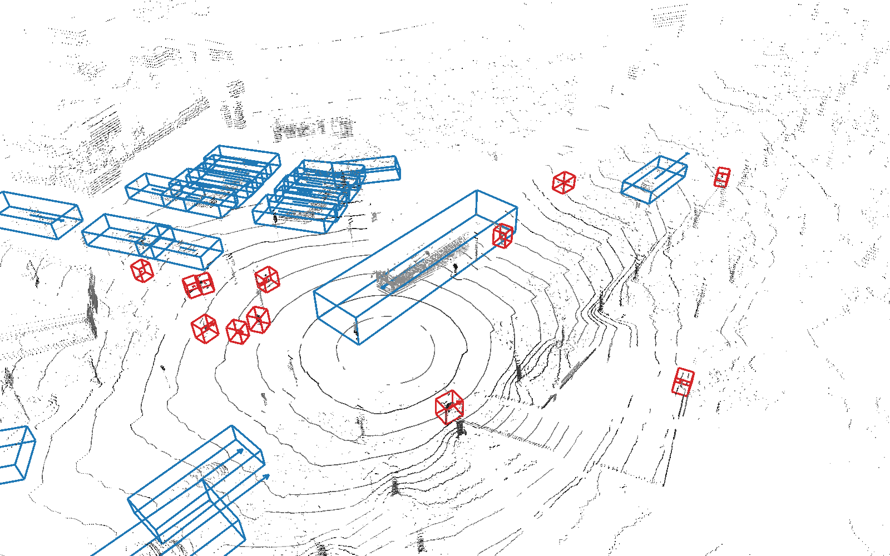

# lidar_pillar_detector

A lidar-only 3D object detector trained on seven public driving datasets and on pseudo-labelled drives of our own
car. It runs on the [autoware_mini](https://github.com/UT-ADL/autoware_mini) research vehicle of the University of
Tartu Autonomous Driving Lab as the `pillar_detector` node. This repository holds the exported model, `pillar_film_v5`,
as one ONNX file with all preprocessing and decoding inside the graph. It also has a one-file inference script and an
example scan with four previous scans. The sibling repository
[lidar_panoptic_segmentation](https://github.com/UT-ADL/lidar_panoptic_segmentation) uses the same example scans.

**Demo video:** <https://youtu.be/hSmaLExwSd8?si=eZymWNIcQgFjZ9iM>



## Quick start

```bash
pip install -r requirements.txt      # numpy, onnxruntime
pip install open3d                   # optional, for --show and --plot
python detect.py example.pcd --show
```

Expected output with `--sweeps 1` (the default) on a CPU with 8 threads. The time depends on the machine, and the last
digit can differ between machines:

```
95566 points (1 previous scans), 41 detections, 6109 ms on CPUExecutionProvider
class             x      y     z     l    w    h   yaw score speed    vx    vy
pedestrian     -4.6   -9.1  -0.9   0.9  0.7  1.8 -0.46  0.76   1.2   1.1  -0.6
bus            12.2    2.6  -0.5  12.6  2.9  3.4  2.91  0.85   6.6  -6.4   1.4
pedestrian     -2.9   12.7  -1.5   0.7  0.7  1.9 -1.38  0.66   0.0  -0.0  -0.0
pedestrian     -5.1   13.4  -1.5   0.7  0.6  1.7 -1.39  0.52   0.6   0.2  -0.6
pedestrian      2.7   16.2  -1.6   0.8  0.7  1.8  2.89  0.75   1.3  -1.2   0.3
pedestrian     -6.3   16.3  -1.3   0.8  0.7  1.9 -0.14  0.71   1.1   1.1  -0.2
car           -19.5    4.5  -1.2   4.4  1.9  1.8 -0.23  0.81   3.9   3.8  -0.9
pedestrian     20.5   -2.9  -0.8   0.8  0.8  1.9  3.04  0.50   0.0  -0.0  -0.0
pedestrian     -0.7   21.8  -1.8   0.6  0.6  1.7  1.02  0.55   0.0  -0.0  -0.0
pedestrian     -1.8   22.5  -1.7   0.6  0.6  1.7 -0.47  0.52   0.0  -0.0  -0.0
car            14.3   21.4  -1.5   4.5  1.9  1.8  1.80  0.85   0.0  -0.0  -0.0
pedestrian      6.4  -25.7  -0.1   0.6  0.7  1.7  1.62  0.55   0.0  -0.0  -0.0
car           -27.0    2.7  -0.7   6.5  2.4  2.5 -0.28  0.80  10.5  10.1  -2.8
car            16.9   21.5  -1.5   4.2  1.9  1.8  1.81  0.76   0.0  -0.0  -0.0
bicycle       -25.9  -11.9  -0.2   1.4  0.7  1.9  2.65  0.63   2.3  -1.8   1.4
pedestrian     -2.2   29.2  -1.7   0.7  0.6  1.8  3.09  0.54   0.0  -0.0  -0.0
car             3.2   29.3  -2.0   4.3  1.9  1.8 -1.42  0.75   0.0  -0.0  -0.0
car            19.4   22.6  -1.5   4.2  1.9  1.8  1.82  0.75   0.0  -0.0  -0.0
pedestrian    -29.8   -2.4  -1.0   0.8  0.7  1.8  2.66  0.69   1.4  -1.2   0.6
car            21.8   22.9  -1.8   4.4  1.9  1.6  1.76  0.73   0.0  -0.0  -0.0
... (21 more, sorted by distance)
```

| Option | Default | Meaning |
|---|---|---|
| `--sweeps` | 1 | previous scans to add, 0-4. 0 gives a single scan without velocity |
| `--style` | `nuscenes` | annotation style (dataset embedding), see [Styles and datasets](#styles-and-datasets) |
| `--lidar_height` | 2.11 | height of the lidar origin above the ground (m); 2.11 for the example |
| `--threshold` | 0.5 | score threshold |
| `--show` | off | show the scan and boxes in an Open3D window |
| `--plot` | none | render the same scene offscreen to a PNG |
| `--model` | `pillar_film_v5_fp16.onnx` | ONNX model |
| `--threads` | min(8, CPU count) | ONNX Runtime CPU threads |
| `--cpu` | off | use the CPU even if CUDA is available |

- **Output:** one line per object with class, centre x y z, size l w h, yaw, score, and the speed, vx and vy in m/s
  over the ground. The scene shows the current scan shaded by intensity and the boxes coloured by class group, with
  a heading line from the centre to the front and a velocity arrow covering 1 s of motion.
- **PCD files:** `detect.py` reads ascii and binary PCD with fields `x y z` and optionally `intensity`, without Open3D.
- **Open3D:** tested with open3d 0.19.0. `--show` needs a display. `--plot` renders offscreen; on a machine without a
  GPU, set `OPEN3D_CPU_RENDERING=true EGL_PLATFORM=surfaceless`.
- **GPU:** install `onnxruntime-gpu` instead of `onnxruntime`. The `cuda,cudnn` extras bring the CUDA libraries as
  pip wheels:

| GPU | Install | Tested |
|---|---|---|
| Ampere or newer | `pip install numpy "onnxruntime-gpu[cuda,cudnn]"` | A100, onnxruntime-gpu 1.31.1, CUDA 13 |
| Volta (V100) | `pip install numpy "onnxruntime-gpu[cuda,cudnn]==1.22.0" "nvidia-cudnn-cu12==9.10.2.21"` | V100. CUDA 13 dropped Volta, and cuDNN 9.27 fails on it |

### Example scans

| File | Content |
|---|---|
| `example.pcd` | the current scan, Velodyne VLP-32C on our Lexus, lab drive of 2026-04-22 |
| `example_sweep_1.pcd` … `example_sweep_4.pcd` | the four previous scans, 1 the newest |
| `sweeps.json` | `{"lag": [0.1, 0.2, 0.3, 0.4]}`, the age of each previous scan in seconds (measured 0.0995, 0.1997, 0.2999, 0.3995) |

- **Frame:** all five files are in the current scan's lidar frame: origin at the lidar, x forward, y left, z up,
  with no ground shift. The previous scans are ego-motion compensated with the car's Novatel odometry and the
  base_link-to-lidar extrinsic calibration.
- **Lidar height:** the lidar is 2.11 m above the ground. This is the TF transform from `base_footprint` to the lidar
  that autoware_mini uses.
- **Points:** binary float32 x y z intensity, with raw intensity 0-255.
- **Minimum range:** points closer than 2.7 m, the car's lidar driver minimum, were removed from the previous scans in
  their own frame. The current scan is unfiltered. Neither the autoware_mini node nor `detect.py` applies a range cut,
  because on the car the lidar driver already does.
- **Use:** the scans are not part of any evaluation set and are licensed CC BY 4.0, see [License](#license).

## ONNX contract

**Inputs**

| Name | Type, shape | Content |
|---|---|---|
| `points` | float32 [131072, 5] | x, y, z (m, lidar frame), raw intensity, time lag (s, 0 for the current scan). Unused rows: `[0, 0, z_min - 100, 0, 0]` |
| `style` | int64 [1] | index into the `styles` metadata; `len(styles)` selects the generic "unknown" style |
| `lidar_height` | float32 [1] | height of the lidar origin above the ground (m) |
| `score_thresh` | float32 [1] | score threshold |

- **Intensity:** raw values of a 0-255 sensor (Velodyne, Hesai). The graph divides by 255 and clips to [0, 1], so
  multiply 0-1 intensities by 255.
- **Points:** pass the whole scan, with no range or ground filtering. Points outside the grid are ignored.

**Output** `boxes`, float32 [1, 100, 11], in the lidar frame. Rows dropped by the threshold or NMS have score 0.

| Column | 0 | 1 | 2 | 3 | 4 | 5 | 6 | 7 | 8 | 9 | 10 |
|---|---|---|---|---|---|---|---|---|---|---|---|
| Value | x | y | z (box centre) | length | width | height | yaw (rad, from x towards y) | score | class index | vx (m/s) | vy (m/s) |

**Metadata** (JSON strings, `session.get_modelmeta().custom_metadata_map`)

| Key | Value |
|---|---|
| `grid` | `{"x_min": -76.8, "x_max": 76.8, "y_min": -76.8, "y_max": 76.8, "z_min": -1.0, "z_max": 4.0, "voxel": 0.1, "max_pillars": 100000, "max_points": 16, "max_input_points": 131072}` |
| `class_names` | `animal, barrier, bicycle, bicycle_rack, bus, car, construction_vehicle, debris, emergency_vehicle, motorcycle, pedestrian, personal_mobility, pushable_pullable, stroller, traffic_cone, trailer, truck, wheelchair, unknown` |
| `class_groups` | `animal, obstacle, cyclist, obstacle, vehicle, vehicle, vehicle, obstacle, vehicle, cyclist, pedestrian, cyclist, obstacle, pedestrian, obstacle, vehicle, vehicle, pedestrian, unknown` (one per class) |
| `nms_radius` | `0.4, 0.5, 0.8, 1.0, 3.0, 1.5, 2.5, 0.5, 1.5, 0.8, 0.4, 0.4, 0.5, 0.4, 0.3, 3.0, 2.5, 0.4, 0.5` (m, one per class, applied in the graph) |
| `styles` | `nuscenes, waymo, av2, kitti, lyft, once, pandaset, av1, adl` |
| `sweeps` | `1` (previous scans the model is deployed with) |
| `velocity` | `true` (columns 9-10 are predicted) |

Lists are JSON arrays in the file. `z_min` and `z_max` are relative to the ground after the `lidar_height` shift.

**Model**

| | |
|---|---|
| Pillars | 0.1 m, 4 height slices, up to 16 points per pillar and 100000 pillars, built inside the graph |
| Backbone | BEV residual CNN (widths 64/128/256/384, 2/4/6/3 blocks) with an FPN to a 0.4 m output grid |
| Heads | CenterPoint-style, one class head per dataset taxonomy in training. The export decodes the nuScenes-taxonomy head (19 classes) with class-agnostic objectness, plus velocity |
| Conditioning | a learned embedding per annotation style (FiLM) |
| Decoding | in the graph: score threshold, class-agnostic distance NMS (per-class radius), 100 boxes |
| Parameters | 16.5 M |
| File | fp16 weights in the backbone, heads and style embedding. Inputs, outputs, pillarisation and decoding are fp32. 48 MB |
| Training | 36 epochs, up to 4 previous scans |

## Styles and datasets

The style embedding tells the model which dataset's annotation conventions and sensor to imitate. The output classes
are always the list above. For an unknown lidar, start with `nuscenes`.

| Style | Dataset | Contributed | Licence | Use the style for |
|---|---|---|---|---|
| `nuscenes` | [nuScenes](https://www.nuscenes.org/terms-of-use) | 28130 frames, 32-beam HDL-32E, 18 classes | CC BY-NC-SA 4.0 plus the Motional terms of use (no endorsement, no use of their marks) | **the default.** Deployed on our car, best-tested, calibrated scores |
| `waymo` | [Waymo Open Dataset](https://waymo.com/open/terms/) | 31880 frames, 64-beam top lidar, 4 classes | Waymo Dataset License Agreement for Non-Commercial Use | dense 64-beam lidars |
| `av2` | [Argoverse 2](https://www.argoverse.org/about.html) | 22477 frames, 2 × VLP-32C, 30 classes | CC BY-NC-SA 4.0 | |
| `kitti` | [KITTI](https://www.cvlibs.net/datasets/kitti/) | 3712 frames, HDL-64E, 8 classes, labels in the front camera view only | CC BY-NC-SA 3.0 | |
| `lyft` | Lyft Level 5 Perception | 21419 frames, 40- or 64-beam roof lidar, 7 classes | CC BY-NC-SA 4.0 | |
| `once` | [ONCE](https://once-for-auto-driving.github.io/terms_of_use.html) | 4961 frames, 40-beam lidar, 5 classes | CC BY-NC-SA 4.0 plus the ONCE Terms of Use | |
| `pandaset` | [PandaSet](https://pandaset.org) | 6640 frames, Hesai Pandar64, 27 classes | CC BY 4.0 plus the Scale AI and Hesai terms of use (no identifying persons, no use of their marks) | |
| `av1` | Argoverse 1 | nothing, not used for this model | CC BY-NC-SA 4.0 | don't use, the row is untrained |
| `adl` | own drives, University of Tartu Autonomous Driving Lab | 5645 scans, VLP-32C at 2.11 m, pseudo-labels from an earlier model | CC BY 4.0 for the published example scans; the rest are not published | a VLP-32C or similar sparse roof lidar: better far-range recall, but scores run higher (threshold ~0.66) and more pedestrian false positives |
| unknown (index 9) | all of the above, 10% of training samples | | | a generic fallback; not evaluated separately |

Licences were checked on the dataset websites and in the licence files that ship with the downloads, in November 2026.
Only the training splits were used. Public validation splits and our test set were never trained on.

**Thresholds.** Use 0.5 with the `nuscenes` style, the node's default. With the `adl` style use about 0.66, because its
scores are inflated and 0.5 gives more false positives.

## Multi-sweep input and velocity

The model is deployed with one previous scan (`sweeps: 1`), which gives velocity and improves detection. Build
`points` as the autoware_mini node and `detect.py --sweeps N` do:

| Rows | x, y, z | intensity | lag |
|---|---|---|---|
| current scan | lidar frame at the current scan time | raw | 0 |
| previous scans, newest first (~0.1 s apart, at most 0.45 s old) | transformed into the current lidar frame with the ego poses | raw | age in seconds, > 0 |
| padding up to 131072 rows | 0, 0, z_min - 100 | 0 | 0 |

- **Ego motion:** previous points must be compensated for ego motion, for example by keeping them in a fixed map frame
  and transforming them into the current lidar frame. vx and vy are then over the ground, in the current lidar frame
  axes. Without the compensation, static objects get the ego velocity.
- **Budget:** if the merged cloud has more than 131072 points, the rows beyond are dropped with a warning. The current
  scan comes first, so the oldest previous points go. The example has about 96k points with 1 previous scan and about
  240k with 4, so `--sweeps 4` truncates.
- **Without history:** with only lag-0 points the velocity columns are not meaningful, so don't use them.
- **Sweep count:** up to 4 previous scans were seen in training. More scans give better velocity but worse detection,
  as the results show.

## Results

**Public validation splits.** Each dataset is scored with its own style and its own class head, with 4 previous scans
where the dataset has them (KITTI has none). The evaluation uses 1000 evenly spaced frames per validation split and
the PyTorch model at the final epoch.

| Dataset | Validation frames (used / split) | v5, this model: strict BEV AP / nuScenes AP | v4: strict BEV AP / nuScenes AP |
|---|---|---|---|
| nuScenes | 1000 / 6019 | 0.495 / 0.576 | 0.503 / 0.588 |
| Waymo | 1000 / 4038 | 0.779 / 0.823 | 0.777 / 0.821 |
| Argoverse 2 | 1000 / 4806 | 0.484 / 0.652 | 0.495 / 0.648 |
| KITTI | 1000 / 3769 | 0.643 / 0.656 | 0.634 / 0.633 |
| Lyft | 1000 / 1260 | 0.714 / 0.759 | 0.736 / 0.778 |
| ONCE | 1000 / 3321 | 0.817 / 0.862 | 0.818 / 0.859 |
| PandaSet | 1000 / 1600 | 0.502 / 0.560 | 0.504 / 0.556 |
| **mean** | | **0.633** / 0.698 | **0.638** / 0.698 |

- **Strict BEV AP:** AP|R40 at IoU 0.7 for vehicles and 0.5 for pedestrians, over each dataset's classes.
- **nuScenes AP:** centre-distance AP at 0.5, 1, 2 and 4 m.
- **v4:** the previous model, `pillar_film_v4`, with the same recipe but without our own drives.

**Our test set.** It has 300 labelled VLP-32C scans from Tartu that were never trained on. The scores use the
autoware_mini node code with TensorRT fp16, 1 previous scan and threshold 0.5. Strict mAP is over cars, pedestrians
and buses in front of the car to 50 m. Vehicle recall at score 0.5 is per distance band in front of the car.

| Style | Strict BEV mAP | Vehicle recall, 0-35 / 35-50 / 50-65 / 65-80 m |
|---|---|---|
| `nuscenes` | 0.711 | 0.96 / 0.94 / 0.73 / 0.54 |
| `adl` | 0.722 | 0.99 / 0.98 / 0.96 / 0.80 |
| `nuscenes`, this fp16 file in ONNX Runtime | 0.727 (fp32 weights: 0.721) | |

| Previous scans | 0 | 1 | 2 | 4 |
|---|---|---|---|---|
| Test set, strict BEV mAP (`adl` style) | 0.711 | 0.722 | 0.696 | 0.687 |
| Velocity error of moving objects (m/s) | 3.73 | 1.04 | 0.93 | 0.89 |

| Hardware | Runtime | Per scan |
|---|---|---|
| RTX 2080 Ti (in the car) | TensorRT fp16, inference | 29 ms |
| V100 | TensorRT fp16, node `detect()` with 1 previous scan | 31.5 ms |
| V100 | ONNX Runtime CUDA, `detect.py` | ~110 ms |
| A100 | ONNX Runtime CUDA, `detect.py` | ~55 ms |
| CPU, 8 threads (AMD EPYC 7763) | ONNX Runtime, `detect.py` | 3-6 s |

TensorRT is what makes it real-time. With ONNX Runtime's CUDA provider some graph nodes fall back to the CPU.

## License

| Part | Licence |
|---|---|
| Code (`detect.py`) | MIT, see [LICENSE](LICENSE) |
| Model weights (`pillar_film_v5_fp16.onnx`) | CC BY-NC-SA 4.0, and the Waymo Dataset License Agreement for Non-Commercial Use in [WAYMO_LICENSE.txt](WAYMO_LICENSE.txt) |
| Example scans (`example*.pcd`, `sweeps.json`) | CC BY 4.0 |

Model weights and example scans: Copyright (c) University of Tartu, Autonomous Driving Lab, 2026.

**Model weights.** The weights are licensed under the
[Creative Commons Attribution-NonCommercial-ShareAlike 4.0 International](https://creativecommons.org/licenses/by-nc-sa/4.0/legalcode)
licence. They were trained on the datasets in [Styles and datasets](#styles-and-datasets) and on pseudo-labelled
scans of our own drives. Several of these datasets allow only non-commercial use and some require derived works to be
shared alike, so the weights are released non-commercial and share-alike. Each dataset's own terms also apply. Where
they are stricter than CC BY-NC-SA 4.0, the stricter terms govern.

**Waymo Open Dataset.** The model was trained in part on the Waymo Open Dataset. The weights are therefore released
under the Waymo Dataset License Agreement for Non-Commercial Use (March 2025). A copy is in
[WAYMO_LICENSE.txt](WAYMO_LICENSE.txt), and the authoritative text is at <https://waymo.com/open/terms/>.

- **Distribution, Section 2(c):** the agreement allows publishing trained weights on four conditions.
  - A prominent notice must say that the model is released under the agreement and that any downstream use or
    modification is subject to it, including the non-commercial restrictions of Section 4. This section is that notice.
  - The agreement applies to the whole model, and added terms must not conflict with it.
  - Every recipient gets a copy of the agreement.
  - The attribution of Section 1 is given.
- **Restrictions, Section 4(a):** neither the model nor its weights may be used or deployed, in whole or in part, in
  operation of a vehicle or to assist in the operation of a vehicle, in any production system, or for any other
  primarily commercial purpose.
- **Breach, Section 4(b):** use for anything other than a non-commercial purpose voids the rights to the model.

> This model was made using the Waymo Open Dataset, provided by Waymo LLC under the Waymo Dataset License Agreement
> for Non-Commercial Use, available at waymo.com/open/terms, and your access and use of such work are governed by the
> terms and conditions therein.

**Attributions**

- nuScenes: (c) Motional AD Inc., CC BY-NC-SA 4.0 with the nuScenes Terms of Use. Motional does not endorse this work.
- Argoverse 2: (c) 2021 Argo AI, LLC, CC BY-NC-SA 4.0.
- KITTI: Geiger et al., Karlsruhe Institute of Technology and Toyota Technological Institute at Chicago, CC BY-NC-SA 3.0.
- Lyft Level 5: (c) 2019-2020 Lyft, Inc., CC BY-NC-SA 4.0.
- ONCE: Huawei Noah's Ark Lab, CC BY-NC-SA 4.0 with the ONCE Terms of Use.
- PandaSet: (c) Scale AI, Inc. and Hesai Photonics Technology Co., Ltd, CC BY 4.0 with the PandaSet Dataset Terms of Use.
  The model must not be used to identify persons in the data.

No dataset owner endorses this model or is affiliated with it.

**Example scans.** The example scans are licensed under
[Creative Commons Attribution 4.0 International](https://creativecommons.org/licenses/by/4.0/) (CC BY 4.0).

## Related

| Repository | |
|---|---|
| [autoware_mini](https://github.com/UT-ADL/autoware_mini) | the autonomy software. Its `pillar_detector` node runs this model with TensorRT, reads `lidar_height` from TF and keeps one previous scan |
| [lidar_panoptic_segmentation](https://github.com/UT-ADL/lidar_panoptic_segmentation) | lidar panoptic segmentation for the same car, with the same example scans |
| training repository | training, export and evaluation code, internal to the University of Tartu |
